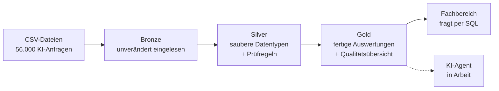

# Verlässliche Daten für KI-Agenten

**Ein KI-Agent beantwortet jede Frage. Auch dann, wenn die Daten darunter falsch sind.**

Dieses Projekt zeigt an einem durchgängigen Beispiel, wie man das verhindert: mit einer Datenstrecke, die Fehler findet, offen meldet und einem Menschen die Entscheidung überlässt. Gebaut im Databricks Lakehouse, komplett im Browser, mit frei erfundenen Beispieldaten.

Das Beispiel: Ein Unternehmen will wissen, **was KI kostet, wer sie nutzt und ob die Anwendungsfälle sauber freigegeben sind.**



## Was die Pipeline findet

In den Beispieldaten stecken vier absichtlich eingebaute Fehler. Die Pipeline findet alle vier:

| Prüfung | Betroffen | Anteil | Ampel | Zuständig |
|---|---|---|---|---|
| Ereignisse ohne Anwendungsfall | 1.102 von 55.722 | 1,98 % | 🔴 rot | Fachbereich / KI-Verantwortliche |
| Nutzer mit unbekannter Abteilung | 5 von 220 | 2,27 % | 🔴 rot | Personal / Stammdaten |
| Nutzung nach dem Austritt | 174 von 55.722 | 0,31 % | 🟡 gelb | IT / Personal |
| Doppelte Ereignisse | 139 von 55.861 | 0,25 % | 🟡 gelb | Quellsystem / IT |

Zu jeder Zeile liefert die Auswertung eine Erklärung in Alltagssprache und eine Empfehlung. Eine zweite Tabelle nennt jeden einzelnen betroffenen Datensatz.

## Der Grundsatz: melden statt still reparieren

Viele Datenstrecken sortieren fehlerhafte Zeilen einfach aus. Die Zahlen sehen danach sauber aus, und niemand erfährt, dass etwas fehlt. Hier gibt es nur zwei Arten von Prüfregeln:

- **Melden:** Die Zeile bleibt erhalten, der Verstoß wird gezählt und angezeigt. Das gilt für die vier Fehler oben.
- **Stoppen:** Die Pipeline bricht ab. Das gilt nur für Fehler, bei denen jede Auswertung falsch würde, zum Beispiel ein unbekannter Status.

Keine Regel entfernt Zeilen stillschweigend. Insgesamt prüfen 13 Regeln die Daten bei jedem Lauf, 4 melden und 9 stoppen.

Was das praktisch bedeutet, zeigt die Kostenauswertung: Die Kosten der fünf Nutzer ohne bekannte Abteilung verschwinden nicht, sie erscheinen unter „Unbekannt“. Die Summe stimmt, und die Qualitätsübersicht sagt, wer die Zuordnung nachpflegen kann.

## Fünf Fachfragen

| Frage | Auswertung im Schema `ki_nutzung.gold` |
|---|---|
| 1. Was kostet KI pro Abteilung und Monat? | `mart_kosten_je_abteilung_monat` |
| 2. Wie viele aktive Nutzer gibt es je Monat? | `mart_aktive_nutzer_monat` |
| 3. Welcher Anteil der Anwendungsfälle ist freigegeben und dokumentiert? | `mart_anwendungsfaelle_konformitaet` |
| 4. Welche Anwendungsfälle kosten je Anfrage am meisten? | `mart_kosten_je_anwendungsfall` |
| 5. Wo liegen Datenqualitätsprobleme? | `mart_datenqualitaet` und `mart_datenqualitaet_details` |

## Gleiche Fragen, andere Plattform

Dieselben Daten und dieselben fünf Fragen habe ich zuvor mit Snowflake und dbt umgesetzt: [ki-nutzung-kosten-analytics](https://github.com/lea-zimmer-data/ki-nutzung-kosten-analytics). Der Datengenerator ist in beiden Projekten dieselbe Datei, die Tabellen heißen gleich, die Rechenregeln sind dieselben.

Der Gedanke dahinter: Die Plattform ist austauschbar. Was bleibt, sind die Fachfragen, die Rechenregeln und die Entscheidung, wie man mit Fehlern umgeht. Ein direkter Vergleich der Ergebnisse beider Plattformen folgt.

## Selbst ausprobieren

Du brauchst einen Browser und eine E-Mail-Adresse. Es wird nichts installiert, und die Databricks Free Edition ist kostenlos.

**[Schnellstart für absolute Anfänger](docs/schnellstart-anfaenger.md)**: in etwa 45 bis 60 Minuten vom leeren Konto bis zur ersten Auswertung, ohne eine Zeile Code zu schreiben. Jeder Schritt nennt, was du danach sehen solltest, und was zu tun ist, wenn etwas nicht klappt.

Wer sich auskennt, braucht nur diese Schritte:

1. Repo als Git-Ordner in Databricks holen
2. `setup/00_einrichtung.sql` ausführen (Katalog, Schemas, Ablage)
3. `setup/01_daten_erzeugen` ausführen (Beispieldaten)
4. ETL-Pipeline anlegen, Quellcode auf den Ordner `pipeline/` zeigen lassen, starten
5. Abfragen im Ordner `auswertungen/` ausführen

## Stand des Projekts

| Baustein | Stand |
|---|---|
| Beispieldaten und Einrichtung | ✅ fertig |
| Pipeline Bronze → Silver → Gold mit Prüfregeln | ✅ fertig |
| Anleitung für Einsteiger | ✅ fertig, wächst mit |
| Vergleich der Ergebnisse mit dem Snowflake-Projekt | in Arbeit |
| Genie Agent: Fragen in normaler Sprache | geplant |
| KI-Agent, der zu jeder Zahl die Datenqualität nennt | geplant |

## Projektstruktur

```
├── setup/
│   ├── 00_einrichtung.sql              # Katalog, Schemas und Ablage anlegen
│   └── 01_daten_erzeugen.py            # Notebook: Beispieldaten erzeugen und prüfen
├── scripts/
│   └── generate_data.py                # Datengenerator, identisch mit dem Snowflake-Projekt
├── pipeline/
│   ├── 01_bronze.sql                   # Rohdaten unverändert einlesen
│   ├── 02_silver.sql                   # Datentypen und Prüfregeln
│   └── 03_gold.sql                     # Auswertungen und Qualitätsübersicht
├── auswertungen/
│   ├── kosten_je_abteilung.sql         # Frage 1
│   ├── datenqualitaet.sql              # Frage 5
│   └── pruefregeln_der_pipeline.sql    # Gegenprobe aus dem Protokoll der Pipeline
└── docs/
    └── schnellstart-anfaenger.md       # Schritt-für-Schritt-Anleitung
```

## Entstehung

Den Code in diesem Repo hat **Claude** (Anthropic) geschrieben, im Dialog mit mir im Chat. Von mir stammen die Fachfragen, die Rechenregeln und die Entscheidungen, zum Beispiel, dass Fehler gemeldet und nicht still repariert werden. Ich habe jeden Schritt selbst in Databricks ausgeführt, die Ergebnisse geprüft und die Anleitung als erste Anwenderin getestet.

Das ist für mich der eigentliche Punkt: Code entsteht heute schnell. Die Arbeit liegt darin, die richtigen Fragen zu stellen, Ergebnisse zu prüfen und die Verantwortung für die Zahlen zu übernehmen.

## Grenzen

- Die Daten sind synthetisch. Preise, Modelle und Mengen sind erfunden und bilden keinen realen Anbieter ab. Die Beträge sind deshalb klein.
- Rund 56.000 Zeilen sind ein Beispiel und kein Lasttest. Das Projekt sagt nichts über große Datenmengen aus.
- Die Pipeline wird per Klick gestartet, es gibt keinen Zeitplan.
- Die Databricks Free Edition ist zum Lernen gedacht und nicht für den kommerziellen Einsatz.
- Das Projekt ist ein Lern- und Vorzeigeprojekt und kein fertiges Produkt.

## Über mich

Ich bin **Lea Zimmer**. Seit über zehn Jahren arbeite ich mit Daten, in BI, Datenmanagement und Data Governance. Mein Schwerpunkt: BI-Teams modernisieren und Fachbereiche so befähigen, dass sie ihre Daten verstehen und selbst damit arbeiten können.

Steht ihr vor ähnlichen Fragen, etwa Datenqualität vor dem KI-Einsatz, ein BI-Team im Umbruch oder Fachbereiche, die selbst auswerten sollen? Dann schreibt mir gern: (https://www.linkedin.com/in/leazimmer/)

## Lizenz

MIT, siehe [LICENSE](LICENSE).
